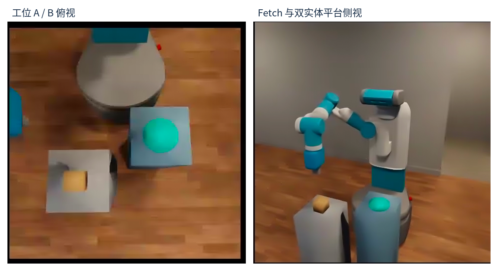

# 工业物流与零售场景移动操作机器人｜ReKep Mobile Manipulation

> **个人项目 · 2026** ｜ 角色：仿真与任务建模 ｜ 关键词：移动操作、关键点约束、RGB-D、Isaac Sim



## 一句话

基于 ReKep 关键点约束框架，把原本只能在桌面上完成的抓取任务，扩展到“工业箱体 A→B 搬运”和“零售桌面拣取”：让机器人自己完成目标定位、抓取、携载移动、移动后重新观察，再放到目标工位。

## 30 秒速览

| 项目 | 内容 |
| --- | --- |
| **我负责** | 场景搭建、RGB-D 目标定位、移动后坐标同步、双航点搬运、移动后重定位与目标更新 |
| **规模** | 26 次参数化实验 + 1 次双工位完整流程 |
| **主结果** | 26 次中 25 次程序成功（96.15%），24 次落位误差 ≤ 3 cm（92.31%） |
| **最硬的一次** | 双工位搬运成功，但最终落位 3.95 cm，未达 3 cm 标准（如实报告） |
| **交付物** | 可运行脚本、场景文件、结果 JSON / CSV、离线复算工具、复盘手册 |

## 我做了什么

1. **搭场景**：在仿真里建了两个有真实碰撞的独立工位 A / B，并做了场景保存与重新加载。
2. **解决坐标问题**：底盘一动，机械臂的 IK 就会用错坐标系；把新的世界到机器人变换同步给环境和两套求解器。
3. **做视觉定位**：不再用仿真真值，改为从 RGB-D 点云估计箱体中心与抓取高度。
4. **做闭环搬运**：把“前进 N 步”改成两个航点的反馈控制，边走边检查有没有夹住。
5. **做移动后重看**：第一次跑到 B 工位时识别失败，于是加双相机 + 区域 + 像素数门禁，并在同一次执行里更新后续阶段的目标。

## 关键结果

| 指标 | 结果 | 说明 |
| --- | --- | --- |
| 参数化实验 | 25 / 26 程序成功（96.15%） | 位置扰动，不是 12 套真实车间布局 |
| 严格精度 | 24 / 26 ≤ 3 cm（92.31%） | 未达标的那次是 5.10 cm |
| 双工位搬运 | 底盘携载 0.3658 m | 两个航点都到达，抓取全程保持 |
| 双工位落位 | 3.95 cm | 通过程序 8 cm 阈值，未过 3 cm 严格标准 |
| 稳定性 | 26 / 26 进程以 -11 退出 | 程序跑完但进程崩溃，问题未解决 |

## 技术栈

`Python` `ReKep` `OmniGibson` `Isaac Sim` `RGB-D` `SE(3)` `IK` `差速底盘控制` `NumPy` `仿真实验设计`

## 适合的岗位方向

- 具身智能 / 机器人算法（移动操作、任务与运动规划）
- 机器人系统集成（仿真、感知、控制联调）
- 自动驾驶 / 机器人仿真与评测工程

## 项目文档

| 想了解 | 去哪里 |
| --- | --- |
| 交付工具包（评测脚本、报告模板） | [`project2_kit/`](project2_kit/) |
| 结果与证据 | [`project2_evidence/`](project2_evidence/) |
| 复现指南与限制 | [`docs/REPRODUCIBILITY.md`](docs/REPRODUCIBILITY.md) |

## 说明

上游 ReKep 规划器与 OmniGibson / Isaac Sim 由开源社区提供，我在此基础上做场景、感知与执行链路的集成和验证。所有数字均可用仓库内的离线脚本复算，**不包含**模型训练或真实机器人部署。

---

## 技术细节（给工程师）

以下为技术说明、实现细节与证据边界，招聘初筛可以跳过。

## 项目简介

在 ReKep 关键点约束任务执行框架上，搭建工业物料搬运与零售取货任务。重点实现基于 RGB-D 的物料定位、Fetch 携载移动、移动后坐标同步、目标工位重新感知，以及运行时 ReKep 目标约束更新。

**个人职责：仿真与任务建模** —— 场景建设、任务流程集成、视觉定位与约束更新、仿真数据记录与验证。

## 系统流程

```text
固定 RGB-D 相机 → 工业箱体/零售商品定位 → ReKep 关键点与约束
     → Fetch 视觉抓取 → 抬升并保持抓取 → 底盘分段移动
     → world-to-robot / IK 坐标同步 → 双相机重新定位 B 工位
     → 更新 Stage 2/3 目标约束 → 规划与释放 → 位置误差评估
```

## 已实现功能

| 能力 | 验证情况 |
| --- | --- |
| Fetch 移动后机器人/IK 坐标系同步 | 已验证 |
| 工业场景 RGB-D 定位与物料抓取、释放 | 已验证 |
| 零售商品 RGB-D 定位与放置 | 已验证（示例场景） |
| 双实体工位搭建、保存、重新加载 | 已验证 |
| 携载物料经过两个底盘航点 | 已验证 |
| 移动后 RGB-D B 工位重定位 | 已验证 |
| 运行时更新 ReKep Stage 2/3 目标约束 | 已验证 |
| 双实体工位完整 A→B 执行 | **程序成功；最终视频落台细节待复核** |
| 无碰撞导航认证/全场景运动规划 | 未完成 |

## 实验结果（真实记录）

| 实验 | 测得结果 | 注释 |
| --- | --- | --- |
| 参数化实验 | **25/26（96.15%）** 程序成功 | 参数位置扰动，不代表 12 个真实布局 |
| 严格水平误差 ≤ 3 cm | **24/26（92.31%）** | 同一批 26 次实验 |
| 双工位携载移动 | **0.3658 m** | 两航点到达，夹持保持 |
| 双工位 B 区域视觉定位偏差 | **0.00148 m** | 相对场景中配置的 B 参考坐标 |
| 双工位最终水平误差 | **0.03951 m** | 程序成功，但**未达 3 cm 严格标准** |
| 零售视觉执行水平误差 | **0.01820 m** | 单次示例运行 |

注意：26 次评测中的进程均出现过退出错误（SIGSEGV，退出码 -11）；双工位运行也在输出成功记录后出现退出码 139。上述程序层结果不等同于进程稳定性证明。详见 [实验记录与限制](docs/RESULTS.md)。

## 仓库结构

本仓库由三部分组成：**项目主干**（代码、配置、证据）、**交付工具包**（报告模板与评测辅助脚本）、**复盘学习包**（STAR 深度复盘与 VLA 学习材料）。三者用途不同，请不要把后两者当作实验证据。

| 路径 | 内容 | 性质 |
| --- | --- | --- |
| [`project2_tools/`](project2_tools/) | 扩展脚本：双工位集成、RGB-D 定位、移动后坐标同步、批量评测 | 项目主干，依赖上游 ReKep 环境 |
| [`project2_evidence/`](project2_evidence/) | 精选结果 JSON 与 26 次参数化评测 CSV | 项目证据，数值未改动 |
| [`configs/`](configs/) | 双实体工位场景序列化文件 | 项目配置 |
| [`docs/`](docs/) | 导出说明、复现指南、结果边界、Mac 发布流程 | 项目文档 |
| [`project2_kit/`](project2_kit/) | 评测/清洗脚本、失败分类与复用成本模板 | 工程脚手架，**不含实验结果** |
| [`tools/recompute_metrics.py`](tools/recompute_metrics.py) | 不依赖 OmniGibson 的离线复算脚本 | 校验工具 |

> `project2_kit/` 是从独立交付包并入的工程脚手架；个人复盘材料不随本仓库提供。

## 文件导航

- [`project2_tools/25_final_dual_station_logistics.py`](project2_tools/25_final_dual_station_logistics.py) — 双实体工位最终集成执行器
- [`project2_tools/dual_station_box_vision.py`](project2_tools/dual_station_box_vision.py) — 工业箱体 RGB-D 外观定位
- [`project2_tools/station_b_reobserve.py`](project2_tools/station_b_reobserve.py) — B 工位视觉标记定位
- [`project2_tools/mobile_frame_sync.py`](project2_tools/mobile_frame_sync.py) — 底盘移动后的 IK/机器人坐标同步
- [`project2_tools/17_vision_retail_v1.py`](project2_tools/17_vision_retail_v1.py) — 零售视觉任务运行脚本
- [`project2_tools/11_batch_eval.py`](project2_tools/11_batch_eval.py) — 参数化评测脚本
- [`configs/og_scene_file_dual_station_v2.json`](configs/og_scene_file_dual_station_v2.json) — 双实体工位场景序列化文件
- [`project2_evidence/`](project2_evidence/) — 有代表性的结果 JSON 与原始评测 CSV
- [`project2_kit/START_HERE.md`](project2_kit/START_HERE.md) — 交付工具包：从已部署环境到可投递项目档案

`project2_tools/` 还保留了历史实验/构建脚本，用于研究过程溯源；**不应把这些历史脚本都视为最终入口**。

## 本地校验（不需要 Isaac Sim）

一条命令即可在不安装仿真环境的情况下核对本仓库的关键结论：

```bash
python3 tools/recompute_metrics.py
```

它对证据条数做断言，并输出 `PROGRAM_SUCCESS = 25/26`、`STRICT_XY_3CM = 24/26`、`DUAL_BASE_CARRIED_M = 0.36579668494491`、`DUAL_FINAL_XY_M = 0.039512359877380325`。它只验证**已导出的数据**，不重跑机器人动作，也不证明进程稳定性。

## 如何复现

这个项目最初在云端 Ubuntu + RTX 4090 + OmniGibson 4.1.0 + Isaac Sim + ReKep 环境下完成。推荐在**兼容的 Linux GPU 仿真环境**复现；Mac 主要用于代码审阅、仓库管理和结果展示，无需安装 Isaac Sim。

实际运行之前，需要单独获取并配置 [ReKep 上游项目](https://github.com/huangwl18/ReKep)、OmniGibson / Isaac Sim 和相关场景依赖。该导出包尚不足以做到独立的一键安装。详见 [复现指南](docs/REPRODUCIBILITY.md)。

## 视频

此次小型代码导出包中**没有包含 mp4**。云端的双工位运行视频记录在：`videos/2026-11-05-17-45-19.mp4`。待视频由云端导出、复核并脱敏后，可在 GitHub Releases 或 README 中添加链接。

## 致谢与归属

基于 [ReKep (huangwl18/ReKep)](https://github.com/huangwl18/ReKep) 研究与代码接口开展扩展工作。第三方代码、模型和资产应按照其各自授权条款独立获取。本仓库没有默认声称拥有上游组件或数据集版权。

## 相关项目

- [RoboBenchMart-VLA-Portfolio](https://github.com/cutelamb2026/RoboBenchMart-VLA-Portfolio) — 零售移动操作 VLA 评测接入与审计框架（另一个独立项目）
